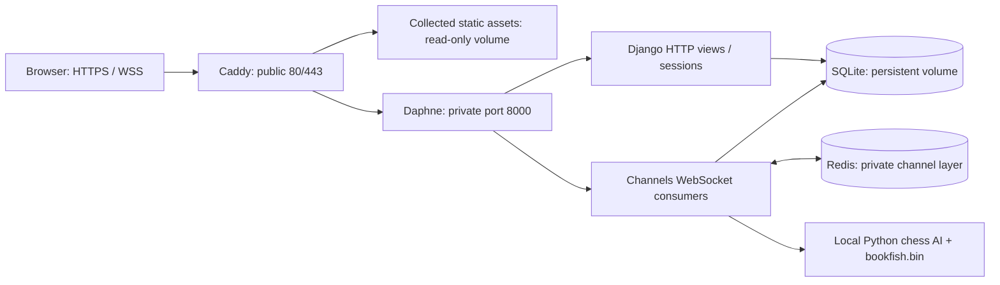

# Chaos Chess on OCI: free-only deployment

Researched against official documentation on **October 8, 2026**. Preparing these
files has not created any Oracle resources. Your starting point is a new Free
Trial/Always Free account with no resources.

## Cost decision

**This app can fit within Always Free. Do not upgrade to Pay As You Go.** Oracle
says your card isn't charged unless you upgrade. Trial credits and Always Free
are different; this plan must remain free after trial credits expire.
[Oracle Free Tier terms](https://docs.oracle.com/en-us/iaas/Content/FreeTier/freetier.htm)

| Item | Configuration | Cost condition |
| --- | --- | --- |
| VM | `VM.Standard.A1.Flex`, 1 OCPU, 6 GB RAM | Unused Always Free entitlement, in home region |
| Boot disk | 50 GB, default performance | Within combined 200 GB free boot/block storage |
| Django, Redis, SQLite | All on the same VM | No separately billed cloud service |
| Hostname | Free Duck DNS subdomain | No domain purchase or OCI DNS zone |
| TLS | Caddy automatic certificates | No certificate purchase |
| Backups | Download database backup to your computer | No managed backup service |

Current free-account A1 allowance is **1,500 OCPU-hours and 9,000 GB-hours/month**,
equivalent to **2 OCPUs/12 GB total**. Older 4 OCPU/24 GB tutorials don't apply to
this account. Our VM uses at most 744 OCPU-hours and 4,464 GB-hours in a 31-day
month. Oracle lists 10 TB/month outbound transfer free. These allowances are
shared across the tenancy. Idle free VMs can be reclaimed; free capacity may be
unavailable. Keep backups outside the VM.
[Oracle Always Free resources](https://docs.oracle.com/en-us/iaas/Content/FreeTier/freetier_topic-Always_Free_Resources.htm)

**Stop if anything is priced above zero, eligibility is unclear, or only paid
capacity is offered.** No paid fallback, Marketplace image, managed database,
managed Redis, load balancer, NAT gateway, paid DNS, or extra disks are included.
A budget alert isn't a spending cap. The script cannot verify your subscription's
billing status or replace current pricing terms. Oracle may place temporary card
verification holds; these differ from service charges.
[Oracle Free Tier FAQ](https://www.oracle.com/cloud/free/faq/)

## What you need to provide

You have already confirmed the account type and absence of resources. Your home
region can be discovered through the CLI. To provision, keep these locally:

- An authenticated OCI CLI profile; browser login is supported.
- Your tenancy OCID, which is an account identifier available in the CLI profile.
- An SSH **public** key file and your current public IPv4 address (`/32`).
- A free hostname, selected after the VM receives its public IP.

Don't send passwords, private keys, session tokens, Duck DNS tokens or card
information into chat. Infrastructure creation is automated; only account login
and choosing the free hostname need account interaction.

## Architecture and deployment requirements



| Code | Responsibility |
| --- | --- |
| `pychess/asgi.py`, `pychess/routing.py` | Initialize Django; route HTTP/WebSockets; validate socket origins; session authentication. Daphne serves `pychess.asgi:application`. |
| `game/views.py`, `pychess/urls.py` | Registration, login, lobby, game joining, match lists, single-player HTML. |
| `game/consumers.py:GameConsumer` | Verify participants, join one Redis group per game, broadcast moves/presence, persist state through `database_sync_to_async`. |
| `game/chaos.py` | Server-side move legality and stamina/defection rules. No external AI service. |
| `game/consumers.py:SingleConsumer`, `game/chessAI.py` | In-process CPU chess search using `python-chess` and bundled `bookfish.bin`. No Stockfish binary or paid LLM. |
| `game/models.py`, `game/migrations/` | Games contain FEN, PGN, winner, presence and Chaos state, linked to Django users. Apply all migrations including `0008`. |
| `game/templates/`, `game/static/` | Server-rendered UI and local images. No Node build. Templates also load JS/CSS from external CDNs. |

Both game templates already select `wss://` for HTTPS pages. HTTP and sockets
share a hostname and session cookie. Plain WSGI cannot handle these sockets;
Daphne serves both protocols. No Celery or Channels `runworker` process is needed.
[Channels deployment](https://channels.readthedocs.io/en/stable/deploying.html)

Redis carries transient group messages, **not saved games**. SQLite holds users,
sessions and durable game state. Redis has no public port, a 128 MB limit, no
eviction, and no disk persistence. After a Redis restart, reload both players'
pages to restore group membership. Daphne's one-hour socket lifetime is below
Redis's default group expiry; the frontend reconnects.
[channels_redis settings](https://github.com/django/channels_redis)

Caddy serves only the static volume, not the database volume. It terminates TLS
and forwards HTTP/WebSocket upgrades with the original Host and proxy scheme.
Django trusts the scheme header because port 8000 is private; never expose it.
Cookies require HTTPS and untrusted socket origins are rejected.
[Caddy proxy](https://caddyserver.com/docs/caddyfile/directives/reverse_proxy),
[Channels origin security](https://channels.readthedocs.io/en/stable/topics/security.html)

The lockfile now targets Python 3.12 and Django 5.2 LTS with compatible
Channels/Daphne packages. The previous Django 5.1 series is unsupported; 5.2 LTS
has extended support through April 2028. Refresh the lock deliberately for
security patches, test, and rebuild.
[Django support schedule](https://www.djangoproject.com/download/)

The repository already tracks `db.sqlite3`; adding it to `.gitignore` doesn't
remove it from Git history. It is excluded from the Docker image and transfer
commands. Review its removal from version control before publishing real user data.

### Limits found in the application

This setup suits a **small demo with trusted players**. Deployment does not fix
all game correctness and abuse-resistance issues:

- Standard chess trusts client-supplied FEN/PGN/results. Chaos validates moves,
  but game-over messages still trust the client. Players can cheat.
- Game joining and Chaos updates are not transactional read/modify/write
  operations. Simultaneous requests can race. Presence uses booleans, so multiple
  tabs and abrupt shutdown can leave inaccurate status.
- The AI uses an in-process shared board and accepts unbounded search depth and
  request frequency. Add server-side limits and isolate CPU work before inviting
  untrusted public traffic.
- Registration bypasses configured Django password validators. Several templates
  still use GET logout links, while current Django requires POST.
- SQLite serializes writes. A longer busy timeout helps brief contention, but
  doesn't add row locks or solve races. Keep one app instance. Before scaling,
  fix transactional updates and consider PostgreSQL running on this same VM;
  that would not require buying a managed database.

6 GB is a reasonable starting allocation, not a measured player-capacity promise.
No A1 load test has been performed.
[Django SQLite limitations](https://docs.djangoproject.com/en/5.2/ref/databases/#sqlite-notes)

## 1. Authenticate the OCI CLI locally

These commands only install local software:

```bash
python3 -m venv ~/.venvs/oci
~/.venvs/oci/bin/pip install oci-cli
export PATH="$HOME/.venvs/oci/bin:$PATH"
oci session authenticate --profile-name CHAOS
export OCI_CLI_PROFILE=CHAOS
export OCI_CLI_AUTH=security_token
```

Complete browser login, using the home region if prompted. Tokens expire; repeat
authentication when needed. Keep the exports in the same terminal.
[OCI token authentication](https://docs.oracle.com/en-us/iaas/Content/API/SDKDocs/clitoken.htm)

Read only the tenancy identifier from that profile:

```bash
export CHAOS_TENANCY="$(python3 - <<'PY'
import configparser
from pathlib import Path
config = configparser.ConfigParser()
config.read(Path.home() / '.oci/config')
print(config['CHAOS']['tenancy'])
PY
)"
```

Create a dedicated SSH key if one doesn't already exist:

```bash
ssh-keygen -t ed25519 -f ~/.ssh/chaos_chess -C chaos-chess
```

Use a passphrase, keep the private half local, and don't overwrite an existing
key. Find your current public IPv4 from your network/router. Replace
`YOUR_PUBLIC_IPV4/32` below with that address.

## 2. Preview, then create the fixed free configuration

From this project directory:

```bash
python3 deploy/oci_free_vm.py \
  --tenancy "$CHAOS_TENANCY" \
  --ssh-public-key ~/.ssh/chaos_chess.pub \
  --ssh-cidr YOUR_PUBLIC_IPV4/32
```

**This is read-only.** It discovers the home region, AD and official Ubuntu 24.04
ARM image, checks all returned compartments for existing compute/boot/block
storage, and prints the plan. Use administrator access for complete inventory;
failed inventory requests stop the script. Existing compute/storage causes it to
refuse rather than guess the remaining allowance. Inventory covers the home
region; it is not a billing check. Don't create other resources concurrently.

After reviewing the plan against the current account entitlement, creation uses
the same command with two explicit flags:

```bash
python3 deploy/oci_free_vm.py \
  --tenancy "$CHAOS_TENANCY" \
  --ssh-public-key ~/.ssh/chaos_chess.pub \
  --ssh-cidr YOUR_PUBLIC_IPV4/32 \
  --apply --confirm-free-account
```

It creates one VCN, internet gateway, route table, security list, public subnet,
and the fixed VM/boot disk. SSH is restricted to your `/32`; TCP 80/443 and ICMP
fragmentation-needed messages are allowed publicly. No 6379/8000 ingress. The
subnet uses only the custom security list, not the default SSH-open list.
[OCI security lists](https://docs.oracle.com/en-us/iaas/Content/Network/Concepts/securitylists.htm),
[OCI launch CLI](https://docs.oracle.com/en-us/iaas/tools/oci-cli/latest/oci_cli_docs/cmdref/compute/instance/launch.html)

The script prints the public IP and journals OCIDs in `.oci-state.json`. Keep it:
a second run refuses to create duplicates. After a failure/timeout, inspect the
journal and actual OCI resources. A `pending` entry means a write may have
succeeded. Don't delete the journal merely to bypass this guard. Partial
networking may remain; reconcile it before retrying. No paid-capacity fallback
or automatic retries occur. Wait if A1 capacity is unavailable.

Cloud-init installs Docker Engine/Compose through Docker's Ubuntu repository:

```bash
ssh -i ~/.ssh/chaos_chess ubuntu@VM_PUBLIC_IP
sudo cloud-init status --wait
sudo docker compose version
```

If bootstrap failed, inspect `/var/log/cloud-init-output.log`. It is designed for
a fresh Ubuntu 24.04 VM. [Docker installation](https://docs.docker.com/engine/install/ubuntu/)

## 3. Use a free hostname

Create a free subdomain at [Duck DNS](https://www.duckdns.org/), such as
`your-chess-name.duckdns.org`, and set its IPv4 address to the VM's public IP.
Leave IPv6 empty unless configured. Keep the DNS token private. No purchased
domain or OCI DNS service is needed. Verify from your computer:

```bash
getent ahostsv4 your-chess-name.duckdns.org
```

Caddy obtains/renews certificates once DNS and public TCP 80/443 reach this VM.
Update the record if you recreate the VM. This configuration uses the hostname,
not a raw public IP. [Caddy HTTPS](https://caddyserver.com/docs/automatic-https)

## 4. Transfer the working tree and run the app

These deployment files and some game changes are uncommitted. Cloning GitHub
alone would miss them. From your computer's project directory:

```bash
rsync -az --exclude='.git' --exclude='.venv' --exclude='.env*' \
  --exclude='__pycache__' --exclude='*.sqlite3*' --exclude='backups' \
  --exclude='graphify-out' --exclude='.oci-state.json' \
  -e 'ssh -i ~/.ssh/chaos_chess' ./ ubuntu@VM_PUBLIC_IP:~/chaos-chess/
```

This starts a fresh production database. It does not copy local users or secrets.
On the VM, create `.env` once; don't regenerate the secret on updates:

```bash
cd ~/chaos-chess
python3 - <<'PY'
import os
import secrets
fd = os.open('.env', os.O_WRONLY | os.O_CREAT | os.O_EXCL, 0o600)
with os.fdopen(fd, 'w') as file:
    file.write('DOMAIN=your-chess-name.duckdns.org\n')
    file.write('SECRET_KEY=' + secrets.token_urlsafe(64) + '\n')
PY
nano .env
sudo docker compose config --quiet
sudo docker compose up -d --build --wait
sudo docker compose ps
sudo docker compose logs --tail=100 app caddy redis
```

Set `DOMAIN` to the actual hostname without scheme, path or port. The generated
secret isn't printed. Production startup checks settings, migrates and collects
static assets. The app runs as UID 10001; new volumes inherit directory ownership.
Redis/app readiness gates Caddy startup. `/healthz/` checks SQL and Redis.
Logs rotate to limit disk usage. Restart policies handle exits/reboots; an
`unhealthy` status alone does not trigger a Docker restart.

## 5. Verify the site

```bash
curl -I http://your-chess-name.duckdns.org
curl --fail https://your-chess-name.duckdns.org/healthz/
curl -I https://your-chess-name.duckdns.org/static/chessboard/wP.png
sudo docker compose exec app python manage.py check --deploy --fail-level WARNING
sudo docker compose exec app python manage.py createsuperuser
```

Expect an HTTPS redirect, health JSON `{"status":"ok"}`, and a successful image
response. Register two users in separate browser profiles; create/join a Chaos
game and move `e2` to `e4`. Both boards must update. Reload to check persistence.
Browser Network → WS should show **101** and `wss://YOUR_HOST/game/ID`. Test
standard chess and single-player separately.

## Backups, updates and restore

`app_data` holds the database; `static_data` holds rebuildable assets;
`caddy_data`/`caddy_config` hold certificate/configuration state. Never use
`docker compose down -v` unless you intend to delete those volumes. Rebuilds and
ordinary restarts preserve them, but VM/disk deletion can lose everything.

On the VM, make a consistent SQLite backup, even while the app is running:

```bash
cd ~/chaos-chess
backup_name="db-$(date -u +%Y%m%dT%H%M%SZ).sqlite3"
mkdir -p backups
chmod 700 backups
sudo docker compose exec app python deploy/backup_sqlite.py "/data/$backup_name"
sudo docker compose cp "app:/data/$backup_name" "backups/$backup_name"
sudo chown "$USER:$USER" "backups/$backup_name"
chmod 600 "backups/$backup_name"
```

From your computer:

```bash
scp -i ~/.ssh/chaos_chess ubuntu@VM_PUBLIC_IP:~/chaos-chess/backups/EXACT_FILENAME ./
```

Protect backups and the production secret; they contain sensitive account/session
data. Remove old VM backup copies after verifying the downloaded copies, so they
don't fill the disk. The helper uses SQLite's backup API and validates integrity,
not a raw live-file copy. [SQLite backup API](https://docs.python.org/3/library/sqlite3.html#sqlite3.Connection.backup)

For updates: back up first, rsync new source, then run
`sudo docker compose up -d --build --wait`. Use a quiet period: restarts disconnect
games. Keep the previous source/lockfile plus pre-update database for rollback;
old code may be incompatible with a new migration.

Restore a verified backup only with the app stopped. This replaces current data;
back up that data first:

```bash
sudo docker compose stop app
sudo docker compose run --rm --no-deps --user root \
  -v "$PWD/backups:/restore:ro" app sh -ec \
  'test -f /restore/EXACT_FILENAME; rm -f /data/db.sqlite3-wal /data/db.sqlite3-shm; cp /restore/EXACT_FILENAME /data/db.sqlite3; chown 10001:10001 /data/db.sqlite3; chmod 600 /data/db.sqlite3'
sudo docker compose up -d --wait
```

To migrate your existing local database, first create a consistent local backup
with `DATABASE_PATH="$PWD/db.sqlite3" python3 deploy/backup_sqlite.py
/tmp/chaos-import.sqlite3`. Upload that file to the VM's `backups/` directory,
then use the stopped-app restore procedure. Never bake a live database into the
Docker image.

## Troubleshooting

| Symptom | Check |
| --- | --- |
| A1 capacity unavailable | Wait; no paid fallback. Reconcile journal/resources before another attempt. |
| Expired CLI token | Repeat browser authentication; export `OCI_CLI_AUTH=security_token`. |
| SSH timeout | IP, internet gateway route, SSH source `/32` matches your network. |
| Website timeout | DNS, OCI security list, guest firewall, Caddy process/ports. |
| TLS failure | Correct A record, no stale AAAA, public 80/443, Caddy logs. Preserve certificate volume. |
| Django 400 / socket rejection | Hostname and browser Origin match `DOMAIN`. Don't browse by raw IP. |
| CSRF / redirect loop | Original Host and Caddy HTTPS proxy header; keep app port private. |
| Static 404 | Collectstatic logs and static volume mount. |
| SQLite read-only | An old root-owned volume needs ownership repair below. |
| Messages stop after Redis restart | Reload both players' pages to rejoin groups. |
| App unhealthy | App/Redis logs, failed migration, database/Redis reachability. |

For an old root-owned volume, stop the app, run
`sudo docker compose run --rm --no-deps --user root app chown -R 10001:10001 /data /static`,
then restart. The UID is fixed across builds.

OCI's network firewall and the guest firewall both matter. Docker publishes via
forwarding/NAT; `ufw allow` alone isn't a full diagnosis. Inspect
`sudo iptables -S`, `sudo iptables -S DOCKER-USER` and
`sudo iptables -t nat -S`. Don't flush rules or disable OCI metadata protections.
Cloud-init preserves the existing firewall; Docker adds its forwarding rules.
[Oracle Ubuntu networking](https://blogs.oracle.com/developers/enabling-network-traffic-to-ubuntu-images-in-oracle-cloud-infrastructure),
[Docker firewall behavior](https://docs.docker.com/engine/network/packet-filtering-firewalls/)

## Local validation

```bash
pipenv sync
DEBUG=True pipenv run python manage.py test game
pipenv run python -m unittest deploy.test_tools
DEBUG=True pipenv run python manage.py makemigrations --check --dry-run
```

Socket tests default to an in-memory channel layer. To exercise Redis, run a
disposable local Redis on an unused port and set
`TEST_REDIS_URL=redis://127.0.0.1:16379/0` while running
`DEBUG=True pipenv run python manage.py test game.test_deployment`. Never use a
production Redis for tests. Provisioning tests mock all cloud requests.

Docker runtime, an ARM image build, Oracle provisioning, public DNS and certificate
issuance still require checks on the VM. Local tests don't imply those external
steps have already happened.

Verified here: 7 Django tests, 6 deployment-tool tests, all 4 deployment Django
tests rerun against a disposable Redis server, a production Daphne HTTP/login/health
smoke test with a fresh SQLite database, migrations, static collection, dependency
consistency, strict Django deployment checks, Compose parsing, OCI CLI parameter
schemas, and shell/cloud-init syntax. The local Redis is 6.0.16; the deployment
image is Redis 7. The OCI tests mock requests and create no resources. Docker's
daemon is inaccessible in this session, so a container build/start was not tested.
